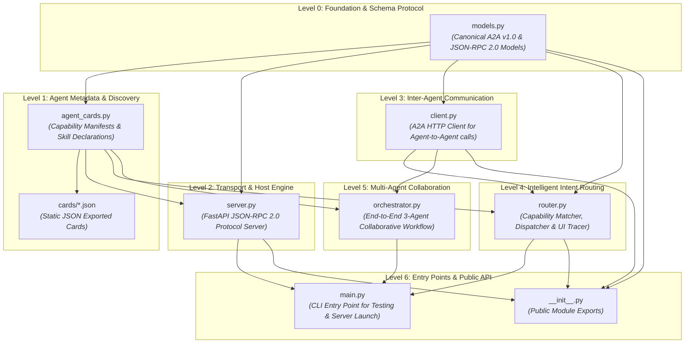
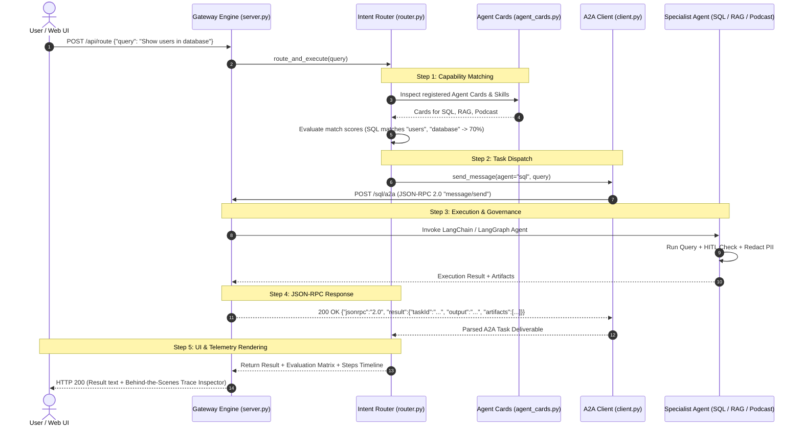
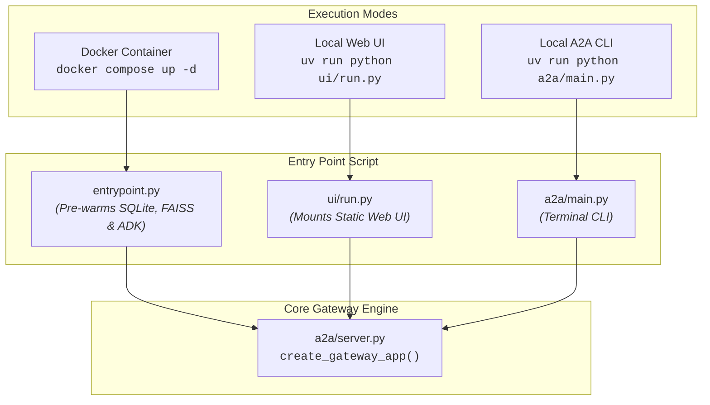

# Google Agent-to-Agent (A2A) Protocol: Architectural Flow & File Guide

This document explains the internal architecture of the `a2a/` module, the chronological development sequence (**which file was created first and why**), and the **end-to-end data flow** connecting our three heterogeneous agents (**Google ADK Podcast Agent**, **LangChain SQL Agent**, and **LangChain RAG Agent**).

---

## 1. High-Level File Organization & Dependency Graph

The `a2a/` folder is designed in strict **layered architectural levels**, moving from protocol primitives up to high-level multi-agent orchestration:



---

## 2. Chronological Build Sequence: Which File Came First and Why

When building an enterprise multi-agent protocol system, files cannot be created randomly. They follow a **bottom-up dependency order**:

| Sequence | File Name | Role & Architectural Purpose | Why It Came First |
| :---: | :--- | :--- | :--- |
| **Step 1** | **`models.py`** | **The Canonical Data Schema**<br/>Defines all Pydantic models for JSON-RPC 2.0 (`JSONRPCRequest`, `JSONRPCResponse`, `JSONRPCError`) and A2A objects (`AgentCard`, `AgentSkill`, `Task`, `TaskStatus`, `Message`, `Artifact`). | **Foundational Zero-Dependency Rule**: Every other component (server, client, router, orchestrator) must serialize and deserialize standard A2A objects. Without schemas, nothing else can be typed. |
| **Step 2** | **`agent_cards.py`** | **Agent Capability Manifests**<br/>Defines the official Agent Cards for the 3 agents (`sql_database_agent`, `rag_knowledge_agent`, `podcast_studio_agent`) and the Gateway. | **Contract First**: In A2A, an agent cannot be discovered or invoked until its Agent Card (skills, input/output modes, interfaces) is declared. |
| **Step 3** | **`server.py`** | **The Protocol Host & Gateway**<br/>FastAPI server exposing `GET /.well-known/agent-card.json` and `POST /a2a` (handling `message/send`, `tasks/create`, `tasks/get`). Mounts the real agents. | **Server before Client**: You must have a server endpoint listening for JSON-RPC requests before you can write a client to communicate with it. |
| **Step 4** | **`client.py`** | **The A2A HTTP Client**<br/>Reusable Python client used by any agent to query another agent over JSON-RPC 2.0 without knowing the other agent's internal language or framework. | **Agent Independence**: Enables an ADK agent to talk to a LangChain agent using pure HTTP/JSON-RPC without importing the other agent's internal Python packages. |
| **Step 5** | **`router.py`** | **Intelligent Routing & Telemetry**<br/>Compares user queries against all registered Agent Cards, picks the best specialist agent, dispatches the task, and records trace milestones for the UI. | **Orchestration Layer**: Sits between external incoming queries and the specialized agents, ensuring queries reach the right agent automatically. |
| **Step 6** | **`orchestrator.py`** | **Federated Collaboration Pipeline**<br/>Implements cross-agent workflows where SQL, RAG, and Podcast agents collaborate sequentially to build a podcast episode. | **Composite Workflow**: Requires all agents, cards, client, and server to already exist so it can demonstrate multi-agent chaining. |
| **Step 7** | **`main.py`** | **CLI Entry Point**<br/>Command-line interface to launch the server, run the multi-agent demo, inspect cards, or query individual agents. | **User & DevOps Interface**: Glues together all previous modules into executable terminal commands. |
| **Step 8** | **`__init__.py`** | **Package Interface**<br/>Cleanly exports `A2AClient`, `AgentCard`, `Task`, `create_gateway_app`, and `A2ARouter`. | **Packaging**: Standard Python convention allowing external packages (e.g. `entrypoint.py`, `ui/run.py`) to import from `a2a`. |

---

## 3. End-to-End Runtime Data Flow

Here is the exact step-by-step path that data takes when a user asks a question (either via the **Interactive UI** or **curl** / **A2A Client**):



---

## 4. Deep-Dive into Each File in `a2a/`

### 1. `models.py` (The Canonical Protocol Schema)
* **What it does**: Implements the official Linux Foundation / Google Agent-to-Agent (A2A) v1.0 data standard using Pydantic.
* **Key Classes**:
  * `JSONRPCRequest`: Standard JSON-RPC 2.0 request (`jsonrpc: "2.0"`, `method`, `params`, `id`).
  * `JSONRPCResponse`: Standard JSON-RPC 2.0 response (`result`, `error`, `id`).
  * `AgentCard`: Discovery manifest containing agent name, version, supported interfaces, capabilities, skills, and authentication schemes.
  * `AgentSkill`: A discrete capability advertised by an agent (e.g. `query_user_accounts`, `synthesize_podcast_audio`).
  * `Task`: A stateful unit of work with a lifecycle: `SUBMITTED` $\rightarrow$ `WORKING` $\rightarrow$ `COMPLETED` / `FAILED`.
  * `Message` & `MessagePart`: Container for conversational turns exchanged between agents.
  * `Artifact`: Formal deliverable produced by a task (e.g. a SQL query report, a podcast script markdown file, or an MP3 audio file).

---

### 2. `agent_cards.py` (The Capability Directory)
* **What it does**: Defines the "Business Cards" for each agent so they can discover each other without prior hardcoded knowledge.
* **Exported Cards**:
  * `SQL_AGENT_CARD`: Advertises `query_user_accounts` and `hitl_pii_governance` on endpoint `/sql/a2a`.
  * `RAG_AGENT_CARD`: Advertises `semantic_knowledge_retrieval` and `grounded_qa_with_citations` on endpoint `/rag/a2a`.
  * `PODCAST_AGENT_CARD`: Advertises `generate_podcast_script` and `synthesize_podcast_audio` on endpoint `/podcast/a2a`.
  * `GATEWAY_AGENT_CARD`: Aggregates all hosted agents into a single master federation card.

---

### 3. `server.py` (The JSON-RPC 2.0 Server & Agent Host)
* **What it does**: A high-performance FastAPI server that acts as the communication bus.
* **Endpoints Exposed**:
  * `GET /.well-known/agent-card.json`: Standard discovery endpoint returning available agents and their skills.
  * `POST /a2a`: Central JSON-RPC 2.0 gateway endpoint.
  * `POST /sql/a2a`, `POST /rag/a2a`, `POST /podcast/a2a`: Dedicated specialist agent endpoints.
  * `POST /api/route`: Intelligent router endpoint for UI queries.
  * `GET /api/agents`: Lists all agents, their skills, and connection status for the UI.
* **Underlying Agent Connections**:
  * When a request arrives at `/sql/a2a`, it calls [`sql_agent.agent.SQLAgent`](file:///Users/sachinmishra/Desktop/A2A_google/sql_agent/agent.py).
  * When a request arrives at `/rag/a2a`, it calls [`rag_agent.agent.RAGAgent`](file:///Users/sachinmishra/Desktop/A2A_google/rag_agent/agent.py).
  * When a request arrives at `/podcast/a2a`, it calls [`podcast_agent.agent.root_agent`](file:///Users/sachinmishra/Desktop/A2A_google/podcast_agent/agent.py).

---

### 4. `client.py` (The A2A Inter-Agent Client)
* **What it does**: Provides a clean, typed Python interface for calling any A2A-compliant server.
* **Primary Methods**:
  * `discover_agent(base_url)`: Downloads and validates the remote agent's `agent-card.json`.
  * `send_message(context_id, text, role)`: Sends a `message/send` RPC method and waits for completion.
  * `create_task(...)`: Starts a new asynchronous task.
  * `get_task(task_id)`: Polls or retrieves the status and artifacts of a task.
  * `cancel_task(task_id)`: Gracefully terminates an ongoing task.

---

### 5. `router.py` (The Query Router & Trace Collector)
* **What it does**: Dynamically inspects the user's intent and routes it to the optimal agent while collecting diagnostic telemetry.
* **How It Works**:
  1. Compares incoming query tokens against skill keywords and examples in each `AgentCard`.
  2. Generates a **Match Confidence Score** (0% to 100%) for each candidate agent.
  3. Dispatches the query via `A2AClient` or direct execution.
  4. Returns the result bundled with step-by-step trace milestones, allowing the UI to render the behind-the-scenes inspector.

---

### 6. `orchestrator.py` (The Multi-Agent Collaboration Workflow)
* **What it does**: Demonstrates real Agent-to-Agent delegation across completely different frameworks:
  * **Step 1**: Dispatches query to `SQL Agent` (LangChain) $\rightarrow$ retrieves audited account statistics.
  * **Step 2**: Dispatches query to `RAG Agent` (LangChain + FAISS) $\rightarrow$ retrieves technical knowledge and citations.
  * **Step 3**: Bundles outputs from Steps 1 & 2 into a briefing and passes them to `Podcast Agent` (Google ADK) $\rightarrow$ generates a complete podcast episode script between host personas Alex and Morgan.

---

### 7. `main.py` (The A2A Command-Line Interface)
* **What it does**: The developer entry point for executing operations from the terminal.
* **Supported Commands**:
  ```bash
  # Launch the complete A2A server on port 8000
  uv run python a2a/main.py --server --port 8000

  # Run the 3-agent collaborative pipeline demo
  uv run python a2a/main.py --demo

  # Query an individual agent directly over A2A
  uv run python a2a/main.py --query-agent sql --prompt "Show users in database"

  # Inspect all Agent Cards in the terminal
  uv run python a2a/main.py --inspect-cards

  # Export static Agent Card JSON files
  uv run python a2a/main.py --export-cards
  ```

---

## 5. System Entry Points: How the Whole System Starts

Depending on how you run the application, the entry point differs:



1. **Production / Docker**:
   * Runs [`entrypoint.py`](file:///Users/sachinmishra/Desktop/A2A_google/entrypoint.py).
   * Automatically pre-warms all 3 agents (seeds SQLite, builds FAISS index, initializes ADK root coordinator).
   * Launches `create_gateway_app()` on `0.0.0.0:8000`.

2. **Local Browser & UI**:
   * Runs [`ui/run.py`](file:///Users/sachinmishra/Desktop/A2A_google/ui/run.py).
   * Mounts the static UI files from [`ui/`](file:///Users/sachinmishra/Desktop/A2A_google/ui) and opens `http://localhost:8000/ui/`.

3. **CLI Operations**:
   * Runs [`a2a/main.py`](file:///Users/sachinmishra/Desktop/A2A_google/a2a/main.py).
   * Allows testing individual agents or running the end-to-end multi-agent orchestrator demo.
